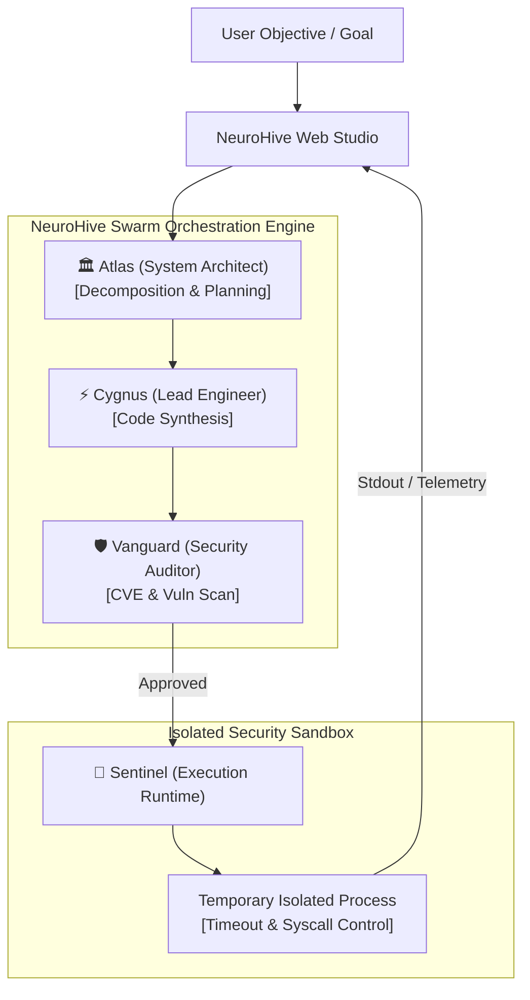

<div align="center">

```
    _   __ ______ __  __ ____  ____   __  __ _____ _    __ ______
   / | / // ____// / / // __ \/ __ \ / / / //  _/| |  / // ____/
  /  |/ // __/  / / / // /_/ // / / // /_/ / / /  | | / // __/   
 / /|  // /___ / /_/ // _, _// /_/ // __  /_/ /   | |/ // /___   
/_/ |_//_____/ \____//_/ |_| \____//_/ /_//___/   |___//_____/   
```

# 🧠 NeuroHive
### Autonomous Multi-Agent Swarm Orchestrator & Sandboxed Code Execution Studio

[](LICENSE)
[](https://www.python.org/downloads/)
[](#)
[](#)
[](#contributing)

*Empowering collaborative AI agent swarms to design, synthesize, statically audit, and safely execute code inside high-security sandboxes—with a live Cyberpunk Web Studio.*

[Quickstart](#-quickstart) • [The Swarm Personas](#-the-swarm-personas) • [Architecture](#-architecture) • [Security Sandbox](#-security-sandbox) • [Automated Tests](#-automated-tests)

---

</div>

## 💥 The Problem
Modern autonomous AI agent architectures suffer from major reliability and security issues:
1. **Hallucination & Syntax Drift:** Single AI agents attempt complex programming tasks without architectural planning or code reviews, producing buggy or broken solutions.
2. **System Destruction Risks:** Executing AI-generated code directly on host servers risks catastrophic data loss, unauthorized system calls, or security breakouts.
3. **Opaque Execution & Zero Visibility:** Developers are locked out of the agent's internal thought loop, making debugging multi-step reasoning impossible.

**NeuroHive** solves this by establishing a disciplined **4-Agent Collaborative Swarm** (Atlas, Cygnus, Vanguard, Sentinel) coupled with an isolated execution sandbox and real-time Web Studio.

---

## 🐝 The Swarm Personas

| Agent Icon | Agent Name | Role | Responsibilities |
| :---: | :---: | :---: | :--- |
| 🏛️ | **Atlas** | System Architect | Decomposes high-level objectives into formal modular specifications and task pipelines. |
| ⚡ | **Cygnus** | Lead Engineer | Synthesizes algorithmic implementations with optimal algorithmic complexity (Python, JS, Shell). |
| 🛡️ | **Vanguard** | Cybersecurity Auditor | Scans synthesized code for CVEs, unauthorized syscalls, and race conditions before execution. |
| 🚀 | **Sentinel** | Sandboxed SRE Engine | Executes cleared code inside isolated temporary runtimes and streams stdout/stderr telemetry. |

---

## 🚀 Key Features

* **🤝 Multi-Agent ReAct Collaboration:** Multi-agent pipeline breaking down complex engineering tasks into discrete planning, coding, auditing, and execution stages.
* **🔒 Isolated Code Execution Sandbox:** Native subprocess isolation with strict timeout quotas, memory limits, and blocking of destructive syscalls.
* **🌐 Cyberpunk Swarm Web Studio:** Real-time web canvas built with modern HTML5/CSS3/JavaScript to launch and monitor agent collaboration visually.
* **⚡ 100% Lightweight & Portable:** Zero heavy external framework dependencies. Starts in less than 50ms on native Linux.

---

## 📦 Quickstart

### 1. Installation

```bash
# Clone the repository
git clone https://github.com/EngJoDev/neurohive.git
cd neurohive

# Verify launcher
./run.sh --version
```

### 2. Launch the Swarm Web Studio

```bash
# Start NeuroHive on port 9090
./run.sh start --port 9090
```

### 3. Open the Studio
Open your browser and visit:  
👉 **`http://localhost:9090`**

Enter any programming or engineering objective (e.g., *"Build and benchmark an optimized algorithm in sandbox"*), click **Launch Swarm 🚀**, and watch the 4 agents collaborate in real time!

---

## 🏛 Architecture



---

## 🔬 Automated Testing

Verify the complete multi-agent pipeline and sandbox security:
```bash
./.venv/bin/python -m unittest discover tests
```
Output:
```text
...
----------------------------------------------------------------------
Ran 3 tests in 0.335s

OK
```

---

## 🤝 Contributing
Contributions, new agent personas, and sandbox drivers are warmly welcomed! Please read [CONTRIBUTING.md](CONTRIBUTING.md).

## 📄 License
This project is licensed under the [MIT License](LICENSE).

---

<div align="center">
  <b>Built with 🧠 and passion by <a href="https://github.com/EngJoDev">Youssef El-Sayed (EngJoDev)</a></b>
</div>
